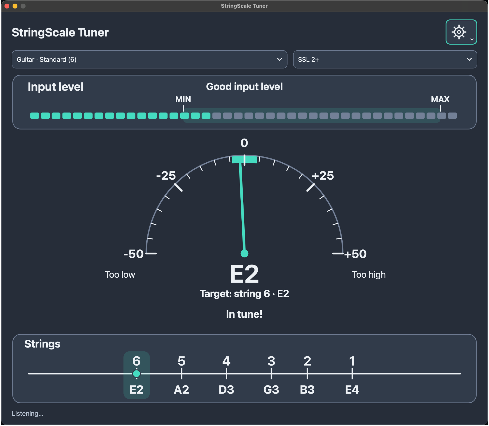

# StringScale Tuner — v0.2.0-alpha.1 (test preview)



**Original, independent, open-source guitar and bass tuner.**

Status: **pre-release testing**. Desktop GUI builds, DSP and capture regressions,
and synthetic GUI previews are checked in CI. Robert has also reported successful
six-string standard tuning and ±25–40 cent tests on Mac/SSL 2+ and Windows 10/UCG-102.
See [hardware results and their scope](docs/HARDWARE_TEST_RESULTS_HU.md).
Other instruments, operating-system versions and interfaces still need testing.
This is not an accuracy-certified tuner; the public release and its dependency
licence bundle are still being prepared. Preview ZIPs are not installers.

## Concept / Koncepció

- **Middle:** classic semicircular analog needle for **−50 to +50 cents**, with
  a clamped needle and text warning for deviations beyond the visible range.
- **Bottom:** horizontal *logarithmic* pitch map, rising from left (low) to
  right (high); **string numbers above**, **note + octave below**; **one theme-colored
  circular indicator precisely on the scale line** driven by detected pitch.
- **Top:** RMS level with minimum gate, peak warning and digital clipping.
- **Tuning selection:** six-string E standard, Drop D, Eb, Open G, DADGAD,
  seven-string guitar, four- and five-string bass.
- Input device and per-device channel selection, configurable level gates, persistent light/dark theme.
- Fixed proportional 75/100/125/150% UI sizes, with screen-fit limits.
- Child-readable Hungarian/English interface; measured note and octave, no Hz readouts.
- Standard manufacturer numbering: highest string = 1, lowest = 6/7 or 4/5.
- No AP Tuner proprietary code, trademark assets, or graphics are used.

## Build — Windows/macOS/Linux development

Requirements:

- C++20 compiler (MSVC 2022, recent Clang or GCC)
- CMake 3.21+
- Qt 6.5+ with **Widgets**, **Multimedia** and **SVG** modules (open-source Qt license
  obligations apply, including LGPLv3 where applicable)

```bash
cmake -S . -B build -DCMAKE_BUILD_TYPE=Release
cmake --build build --config Release
ctest --test-dir build -C Release --output-on-failure
```

With Qt Creator, open `CMakeLists.txt`, select a kit that includes Qt Multimedia,
then configure and run the `StringScaleTuner` target. On macOS, allow microphone
access. Select the connected instrument input or microphone from the `Input`
list, then pluck a string. This is still an experimental build.

### DSP tests without Qt

```bash
cmake -S . -B build-core -DSTRINGS_BUILD_GUI=OFF -DCMAKE_BUILD_TYPE=Release
cmake --build build-core --config Release
ctest --test-dir build-core -C Release --output-on-failure
```

The core tests run on Windows, macOS and Linux in GitHub Actions.
The **Desktop preview** workflow additionally builds and packages the full Qt
application for Windows x64 and macOS arm64. See [the preview guide](docs/PREVIEW_HU.md)
for artifact download and manual testing. The ZIPs are experimental archives; separate unsigned EXE/PKG installer artifacts
are built and smoke-tested by the same workflow. See [installer details](docs/INSTALLERS_HU.md).
The first implementation of the accepted GUI redesign is documented in [the development log](docs/DEVELOPMENT_LOG_HU.md)
with further real-instrument testing required beyond the documented configurations.

## Implementation

- `src/pitch_detector.*`: independent YIN-family implementation using
  cumulative mean-normalized differences and parabolic lag interpolation.
- `src/tuning.*`: fixed pitch references, string numbering, nearest-string
  calculation and cents.
- `src/audio_capture.*`: Qt Multimedia audio input, normalized samples,
  simple low-pass + downsampling to 12 kHz, level measuring and pitch smoothing.
- `src/tuner_widgets.*`: self-painted high-DPI vector instrument widgets.
- `src/main_window.*`: profiles, device controls, live readouts, settings.
- `tests/pitch_detector_test.cpp`: deterministic generated test tones.

**Audio caveats:** Performance, pitch precision, octave tracking, realtime
latency and input-device behavior need validation with actual DI guitar and
bass across macOS/Windows. The YIN-family method is implemented from the
published algorithmic ideas, not copied from any prior tuner project.
The displayed "cent" meter targets the nearest *string reference*, not the
nearest chromatic note. Measured note/octave and target number remain visible
separately. The app cannot identify the intended physical string: an unintended
octave can coincide with another valid string reference.

**Mérés:** a 0 cent target is based on the selected tuning preset and A4
calibration. The audio amplitude gate is not the same as a pitch-confidence
gate. A valid estimate must pass both; brief uncertainty is bridged by a bounded
220 ms hold. Clipping clears pitch immediately.

See `docs/ARCHITECTURE.md` and `docs/ROADMAP.md` for technical details and the
planned release-quality work.

## Rights

Our original source code is MIT-licensed. Qt is a separate third-party
framework with its own license requirements; LGPLv3 compliance may be needed
for publicly distributed binaries. Do not incorporate AP Tuner source code,
logos, UI artwork or protected names without permission.

No warranty; not an accuracy-certified instrument. The documented successful
hardware trials do not establish performance on all instruments or interfaces.

Release preparation: [checklist](docs/RELEASE_CHECKLIST_HU.md) · [hardware test sheet](docs/TEST_CHECKLIST_HU.md).
