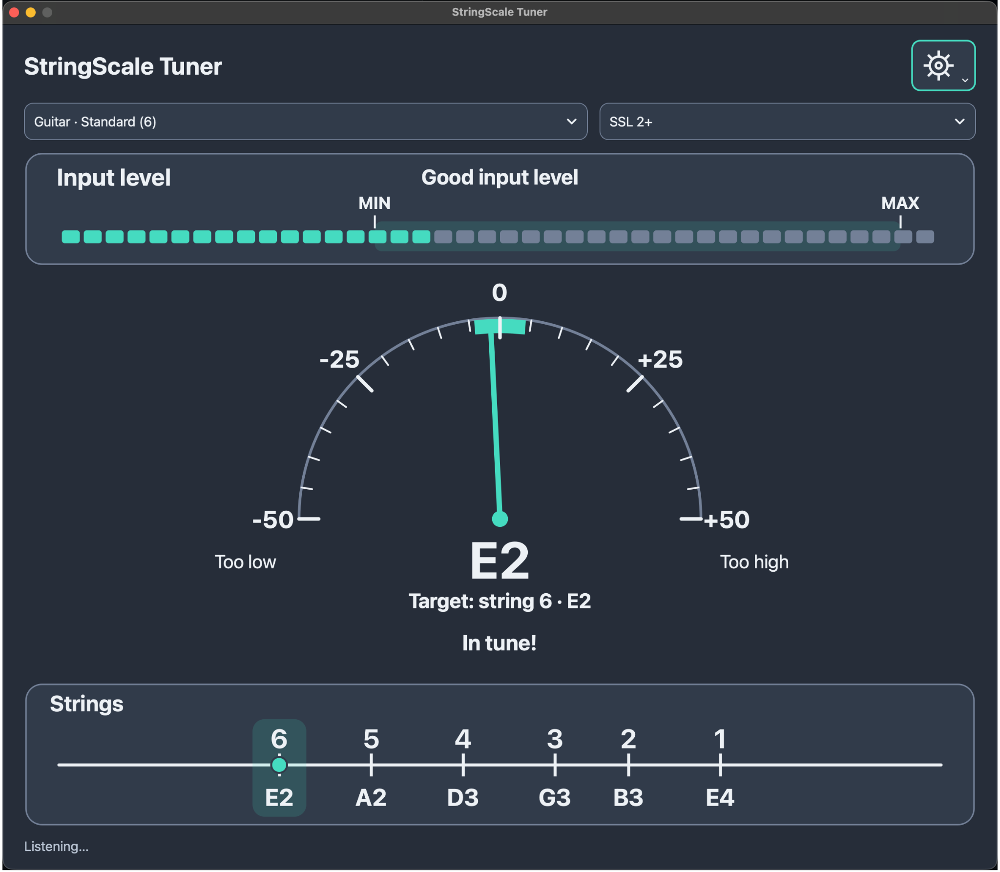

# StringScale Tuner — v0.2.0-alpha.1 (próbaverzió)

[English](README.md) | Magyar



**Önálló, eredeti, nyílt forráskódú gitár- és basszushangoló.**

Állapot: **nyilvános alpha próbaverzió**. A Windows x64 EXE és a macOS
Apple Silicon PKG a [v0.2.0-alpha.1 kiadásból](https://github.com/RobCZart82/StringScale-Tuner/releases/tag/v0.2.0-alpha.1)
tölthető le. A kiadás a függőségek licencértesítéseit és a Qt/FFmpeg
forráscsomagot is tartalmazza.

Robert a publikált telepítőt és az alkalmazást Windows 10-es Intel gépen,
valamint macOS Tahoe alatt M1-en is sikeresen kipróbálta. Telepítéskor az
aláírás nélküli szoftverhez kapcsolódó jóváhagyási lépések megjelentek.
A korábbi Mac/SSL 2+ és Windows 10/UCG-102 próbák a hat standard húrt és a
±25–40 centes eltéréseket is érintették.
Részletek a [hardveres visszajelzésekben](docs/HARDWARE_TEST_RESULTS_HU.md).

A CI az asztali buildet, a DSP- és hangbemeneti regressziókat, a GUI-előnézeteket
és a telepítőpróbákat ellenőrzi. További hangszerek, interfészek és
rendszerkonfigurációk még szélesebb hardveres tesztelést igényelnek.

## Működés

- Középen félköríves analóg mutató −50 és +50 cent között; nagyobb eltérésnél
  a mutató a skála szélén marad, szöveges figyelmeztetéssel.
- Alul balról jobbra emelkedő, logaritmikus hangmagasságskála: fent húrszám,
  lent hangnév és oktáv, a skálavonalon a mért hangot követő körjelölő.
- Felül RMS-jelszint, minimumküszöb, csúcsszintjelzés és digitális túlvezérlés.
- Hat húros standard, Drop D, Eb, Open G, DADGAD, hét húros gitár,
  négy- és öt húros basszusprofil.
- Bemeneti eszköz és eszközönként mentett csatorna; állítható jelszintküszöbök.
- Mentett világos/sötét téma és arányos 75/100/125/150%-os, kijelzőhöz korlátozott méret.
- Jól olvasható magyar/angol felület, hangnévvel és oktávval, Hz-kijelzés nélkül.
- A legmagasabb húr az 1., a legmélyebb a 6/7. vagy 4/5.
- Nem használ AP Tuner-kódot, védjegygrafikát vagy másolt felületi elemeket.

## Fordítás Windows/macOS/Linux fejlesztéshez

C++20 fordító (MSVC 2022, friss Clang vagy GCC), CMake 3.21+ és Qt 6.5+
Widgets, Multimedia, Svg modul szükséges. A Qt külön licencfeltételei érvényesek.

```bash
cmake -S . -B build -DCMAKE_BUILD_TYPE=Release
cmake --build build --config Release
ctest --test-dir build -C Release --output-on-failure
```

Qt Creatorban a CMakeLists.txt fájlt nyisd meg, Multimedia modult tartalmazó
kittel, majd indítsd a StringScaleTuner célt. macOS-en engedélyezd a mikrofont.
Válaszd ki a hangszerbemenetet vagy mikrofont, és pengess meg egy húrt.

### Qt nélküli motortesztek

```bash
cmake -S . -B build-core -DSTRINGS_BUILD_GUI=OFF -DCMAKE_BUILD_TYPE=Release
cmake --build build-core --config Release
ctest --test-dir build-core -C Release --output-on-failure
```

A motortesztek Windows, macOS és Linux alatt futnak a GitHub Actionsben.
A Desktop preview Windows x64 és macOS arm64 alkalmazást csomagol;
a [próbaverzió útmutatója](docs/PREVIEW_HU.md) ismerteti a letöltést.
A külön, kiadói aláírás nélküli EXE/PKG [teszttelepítőket](docs/INSTALLERS_HU.md)
szintén ez a workflow építi és ellenőrzi. A GUI fejlődését a
[fejlesztési napló](docs/DEVELOPMENT_LOG_HU.md) rögzíti.

## Megvalósítás és mérési korlátok

- `src/pitch_detector.*`: önálló YIN-családú motor, normalizált különbséggel
  és parabolikus periódusbecsléssel.
- `src/tuning.*`: referenciahangok, húrszámok, legközelebbi húr és centeltérés.
- `src/audio_capture.*`: Qt hangbemenet, normalizálás, egyszerű aluláteresztés,
  12 kHz-es elemzés, jelszintmérés és hangmagasság-simítás.
- `src/tuner_widgets.*`: saját rajzolású vektoros műszerek.
- `src/main_window.*`: profilok, bemenet, kijelzés, beállítások.
- `tests/pitch_detector_test.cpp`: determinisztikus, generált teszthangok.

A pontosság, oktávkövetés, késleltetés és eszközkezelés további valódi DI gitár-
és basszuspróbát igényel. A motor publikált algoritmikus elvekre épül,
nem más hangolóprogram másolata. A centmérő a legközelebbi kiválasztott
húrreferenciához mér, nem a legközelebbi kromatikus hanghoz. A mért hang/oktáv
és célhúr külön látszik. A program nem tudja, melyik fizikai húrt akartad
hangolni; egy téves oktáv másik érvényes húrreferenciával is egyezhet.

A 0 cent a profil és az A4-kalibráció függvénye; utóbbihoz jelenleg nincs
nyilvános vezérlő. A jelszintküszöb és a becslés megbízhatósági küszöbe külön
feltétel. Rövid bizonytalanságot legfeljebb 220 ms tartás hidal át;
túlvezérléskor eltűnik a mért hang, és friss, tiszta mérési ablak után tér vissza.

Részletek: [architektúra](docs/ARCHITECTURE.md), [ütemterv](docs/ROADMAP_HU.md),
[dokumentációs tartalomjegyzék](docs/README.md).

## Jogok és kiadás

A saját forráskód MIT-licencű. A Qt és más függőségek külön feltételei,
köztük adott esetben LGPLv3-kötelezettségek érvényesek a terjesztett binárisokra.
AP Tuner-kód, logó, grafika vagy védett név engedély nélkül nem építhető be.
Nincs garancia; a sikeres próbák nem igazolnak általános mérési pontosságot.

[Kiadási ellenőrzőlista](docs/RELEASE_CHECKLIST_HU.md) · [Hardveres tesztlap](docs/TEST_CHECKLIST_HU.md)
